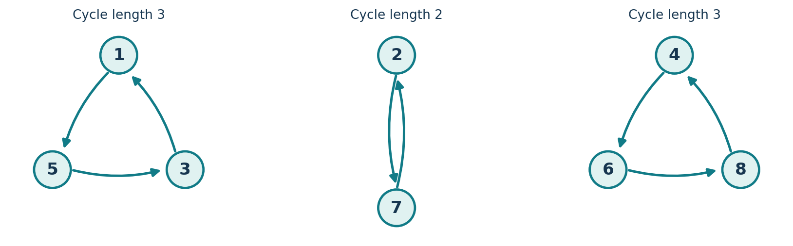
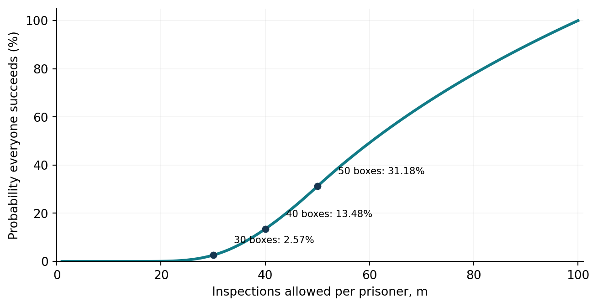
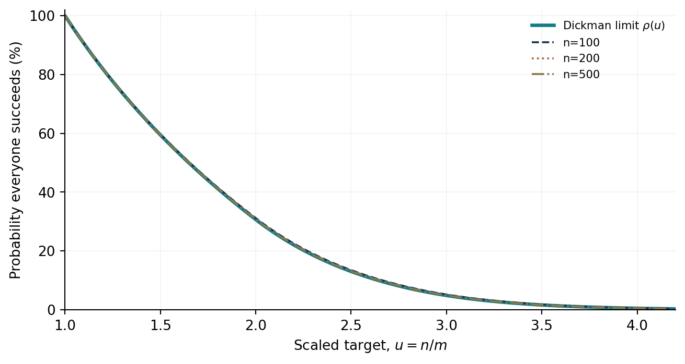

# Prisoners and Dickman

**An exploratory note in probability and combinatorics** · Version 1.0 · 25 October 2026

> **Abstract.** Stumbled upon this pretty interesting and intriguing strategy problem recently. A puzzle about prisoners searching numbered boxes appears to have almost no chance of success. A cycle-following strategy instead succeeds with probability over 31%, even though it does not improve any individual prisoner's 50% chance. We derive this result from random permutation cycles, then ask what happens when the number of boxes each prisoner may open is reduced. The resulting distinction between expected cycle counts and probabilities of existence leads to an exact recurrence for permutations with bounded cycle lengths. Taking its scaling limit brings us to the Dickman delay differential equation. Throughout, our goal is to understand how each mathematical tool becomes necessary.

**Keywords:** random permutations, 100 prisoners problem, cycle decomposition, indicator variables, inclusion–exclusion, harmonic numbers, smooth permutations, Dickman function.

**Contents**

1. [A problem that seems impossible](#1-a-problem-that-seems-impossible)
2. [The cycle-following strategy](#2-the-cycle-following-strategy)
3. [Counting cycles: a tagged element versus existence](#3-counting-cycles-a-tagged-element-versus-existence)
4. [The original probability and its logarithmic approximation](#4-the-original-probability-and-its-logarithmic-approximation)
5. [Fewer inspections: where our shortcut fails](#5-fewer-inspections-where-our-shortcut-fails)
6. [An exact recurrence for arbitrary numbers of prisoners](#6-an-exact-recurrence-for-arbitrary-numbers-of-prisoners)
7. [Numerical checks and reproducible simulation](#7-numerical-checks-and-reproducible-simulation)
8. [A continuum limit and the Dickman function](#8-a-continuum-limit-and-the-dickman-function)
9. [Concluding observations](#9-concluding-observations)
10. [References](#references)

---

## 1. A problem that seems impossible

There are 100 prisoners, numbered 1 through 100, and 100 numbered boxes. Inside the boxes are the numbers 1 through 100, one per box, arranged uniformly at random. Each prisoner may inspect at most 50 boxes, alone; boxes are then closed and the arrangement is left unchanged. Beforehand the prisoners may agree on a strategy, but they cannot communicate during the searches. They win only if **every prisoner finds their own number**.

How unlikely is collective success if everyone simply picks 50 boxes uniformly and independently?

A particular prisoner's number is equally likely to lie in any of the 100 boxes, so their chance of finding it is $`1/2`$. The prisoners' independently chosen sets give independent success events (even conditional on the box arrangement). Thus

```math
P(\text{all succeed under independent search})=\left(\frac12\right)^{100}.
```

A rough estimate is enough to see the scale. Since

```math
2^{10}=1024\approx 10^3,
\qquad
2^{-100}=(2^{10})^{-10}\approx(10^3)^{-10}=10^{-30},
```

the probability is on the order of $`10^{-30}`$. For reference, its numerical value is approximately $`7.89\times10^{-31}`$.

Would a coordinated strategy really improve this by much? Surprisingly, **yes**—and without increasing any one prisoner's marginal chance of success.

## 2. The cycle-following strategy

Let $`\pi(i)`$ be the label inside box $`i`$. Because each label occurs once, $`\pi`$ is a *permutation* of $`\{1,\ldots,100\}`$, and every permutation decomposes uniquely into disjoint cycles.

For example, consider eight boxes arranged as

```math
\pi=(1\;5\;3)(2\;7)(4\;6\;8).
```



Under the **cycle-following strategy**, prisoner $`i`$ opens box $`i`$, then the box whose number they find, and continues this way. For the first cycle, prisoner 1 opens boxes $`1\to5\to3`$. The number 1 appears in the third box inspected. Prisoner 5 traverses the same cycle starting from 5, and also finds their number on the third inspection.

In general, if prisoner $`i`$ belongs to a cycle of length $`k`$, they find their own label on the $`k`$-th inspection. Everyone in that cycle succeeds together if $`k\le m`$, and fails together if $`k>m`$.

**Proposition 1 (Cycle criterion).** Write $`L_{\max}(\pi)`$ for the longest cycle of $`\pi`$. With $`n`$ prisoners and an inspection limit $`m`$, all prisoners succeed under cycle-following if and only if

```math
L_{\max}(\pi)\le m.
```

*Proof.* Each prisoner's path follows precisely their cycle and visits their own label on the final step around that cycle. All searches succeed exactly when every cycle has length at most $`m`$. $`\square`$

This is our first change of viewpoint: **100 apparently separate searches have become a single question about a random permutation.**

## 3. Counting cycles: a tagged element versus existence

### 3.1 How long is the cycle containing a specified prisoner?

Fix prisoner 1, and denote by $`L_1`$ the length of the cycle containing 1.

**Lemma 2 (Uniform tagged-cycle length).** In a uniform random permutation of $`n`$ elements,

```math
\boxed{P(L_1=k)=\frac1n,\qquad k=1,\ldots,n.}
```

*Proof.* To construct a permutation in which 1 belongs to a $`k`$-cycle:

1. Choose the other $`k-1`$ elements of that cycle: $`\binom{n-1}{k-1}`$ choices.
2. List them in the cyclic order following 1: $`(k-1)!`$ choices.
3. Permute the remaining $`n-k`$ elements arbitrarily: $`(n-k)!`$ choices.

Hence the number of favourable permutations is

```math
\binom{n-1}{k-1}(k-1)!(n-k)!=(n-1)!,
```

*independent of* $`k`$. There are $`n!`$ permutations altogether, so $`P(L_1=k)=(n-1)!/n!=1/n`$. $`\square`$

Consequently, under cycle-following,

```math
P(\text{prisoner 1 succeeds})=P(L_1\le m)=\frac mn.
```

For $`n=100,m=50`$, that is still $`1/2`$. The benefit of the strategy is **correlation**: prisoners on the same cycle win or lose together, whereas independently guessed sets lead to independent successes.

### 3.2 Does a cycle of length $`k`$ exist anywhere?

This is **not** the same event as $`L_1=k`$. We now ask whether *some* cycle of length $`k`$ exists, regardless of whether it contains prisoner 1.

Choose the $`k`$ elements, arrange them into one cycle, then permute the remaining elements:

```math
\binom{n}{k}(k-1)!(n-k)!=\frac{n!}{k}.
```

A cycle has $`(k-1)!`$ arrangements, not $`k!`$: cyclic rotations such as $`(1\;2\;3)`$ and $`(2\;3\;1)`$ describe the same cycle.

**Proposition 3 (Existence of a sufficiently long cycle).** For $`k>n/2`$,

```math
\boxed{P(\text{at least one }k\text{-cycle exists})=\frac1k.}
```

*Proof.* When $`k>n/2`$, two distinct $`k`$-cycles cannot fit in a permutation of $`n`$ elements. Thus the construction above counts each permutation with a $`k`$-cycle *exactly once*. Dividing $`n!/k`$ by $`n!`$ gives $`1/k`$. $`\square`$

**A second proof, by conditioning.** Let $`A`$ be the event that a $`k`$-cycle exists, with $`k>n/2`$. Conditional on $`A`$, its $`k`$ members are a uniformly random $`k`$-element subset, so $`P(1\text{ lies in it}\mid A)=k/n`$. Because $`L_1=k`$ implies $`A`$,

```math
\underbrace{P(L_1=k)}_{1/n}
=P(A)\underbrace{P(L_1=k\mid A)}_{k/n},
```

which again yields $`P(A)=1/k`$.

**A warning for later:** when $`k\le n/2`$, there may be two or more $`k`$-cycles. The same construction then counts a permutation once *per* $`k`$-cycle it contains. It will still tell us something useful, but not directly an existence probability.

## 4. The original probability and its logarithmic approximation

With 100 prisoners opening 50 boxes each, the cycle-following strategy fails precisely when a cycle has length in $`\{51,\ldots,100\}`$. Two such cycles cannot coexist, so these events are mutually exclusive.

Therefore,

```math
\begin{aligned}
P(\text{all succeed})
&=1-\sum_{k=51}^{100}\frac1k\\
&=1-(H_{100}-H_{50})\\
&=\boxed{0.3118278207\ldots},
\end{aligned}
```

where $`H_m=\sum_{k=1}^{m}1/k`$ is the $`m`$-th harmonic number.

Thus collective success rises from roughly $`10^{-30}`$ to **31.18%**, even though each prisoner's individual chance remains 50%.

### 4.1 First approximation: a Riemann sum

For $`2m`$ prisoners and a limit of $`m`$ inspections,

```math
q(2m,m)=1-(H_{2m}-H_m).
```

Write the difference as

```math
H_{2m}-H_m
=\frac1m\sum_{j=1}^{m}\frac{1}{1+j/m}
\longrightarrow\int_0^1\frac{dx}{1+x}=\ln2.
```

This recovers our earlier estimate:

```math
\boxed{\lim_{m\to\infty}q(2m,m)=1-\ln2\approx 0.3068528194.}
```

### 4.2 A sharper expansion of the harmonic numbers

The Euler–Maclaurin formula gives the asymptotic expansion

```math
\boxed{
H_m=\ln m+\gamma+\frac{1}{2m}
-\frac{1}{12m^2}+\frac{1}{120m^4}
-\frac{1}{252m^6}+O(m^{-8}),
}
```

where $`\gamma\approx0.57721566`$ is the Euler–Mascheroni constant. The absent odd inverse powers beyond $`1/m`$ are a feature of this expansion.

Replacing $`m`$ by $`2m`$ and subtracting:

```math
\begin{aligned}
H_{2m}-H_m
&=\bigl[\ln(2m)+\gamma+\tfrac1{4m}-\tfrac1{48m^2}+\tfrac1{1920m^4}+\cdots\bigr]\\
&\quad-\bigl[\ln m+\gamma+\tfrac1{2m}-\tfrac1{12m^2}+\tfrac1{120m^4}+\cdots\bigr]\\
&=\ln2-\frac1{4m}+\frac1{16m^2}-\frac1{128m^4}+O(m^{-6}).
\end{aligned}
```

In particular, the constant $`\gamma`$ cancels, and

```math
\boxed{q(2m,m)=1-\ln2+\frac1{4m}-\frac1{16m^2}+\frac1{128m^4}+O(m^{-6}).}
```

At $`m=50`$, the first two corrections already give

```math
1-\ln2+\frac1{200}-\frac1{40{,}000}
\approx0.3118278194,
```

close to the exact $`0.3118278207`$. This explains why the 100-prisoner probability is slightly *above* the limiting value $`1-\ln2`$.

## 5. Fewer inspections: where our shortcut fails

What if each prisoner opens only 40 boxes? We still need all cycles to have length at most 40, but now a permutation with cycle lengths $`(45,45,10)`$ has *two* forbidden cycles. The long-cycle events are no longer disjoint.

This forces us to distinguish **the probability of a forbidden cycle existing** from **the expected number of forbidden cycles**.

### 5.1 Expected number of $`k`$-cycles

Let $`X_k(\pi)`$ denote the number of distinct cycles of length $`k`$ in permutation $`\pi`$.

For example, if $`\pi=(1\;2)(3\;4)(5\;6)`$, then $`X_2(\pi)=3`$, even though the event “a 2-cycle exists” is simply true once.

**Proposition 4 (Expected cycle count).** For every $`1\le k\le n`$,

```math
\boxed{E[X_k]=\frac1k.}
```

*Proof by counting distinguished cycles.* Count pairs $`(\pi,C)`$ consisting of a permutation and **one of its $`k`$-cycles chosen as distinguished**. Choosing the members of $`C`$, arranging them around the cycle, and permuting the rest gives

```math
N_k=\binom{n}{k}(k-1)!(n-k)!=\frac{n!}{k}.
```

Why does this count give an expectation? A permutation with zero $`k`$-cycles contributes zero pairs; with one, it contributes one pair; with three, it contributes three pairs—one for each possible choice of $`C`$. Thus

```math
\sum_{\pi\in S_n}X_k(\pi)=\frac{n!}{k}.
```

Averaging over the $`n!`$ equally likely permutations gives

```math
E[X_k]=\frac1{n!}\sum_{\pi\in S_n}X_k(\pi)=\frac1k.
```

No $`k>n/2`$ assumption was used. $`\square`$

**Why an expectation need not equal an existence probability.** Consider $`k=1`$, so $`X_1`$ counts *fixed points*, boxes whose labels match their box numbers. Define $`I_i=\mathbf1\{\pi(i)=i\}`$. Then

```math
X_1=\sum_{i=1}^{n}I_i,
\qquad E[X_1]=\sum_{i=1}^nP(\pi(i)=i)=n\cdot\frac1n=1.
```

But the $`n`$-cycle $`(1\;2\;\cdots\;n)`$ has **no** fixed point, and has strictly positive probability (for $`n\ge2`$). Thus $`P(X_1\ge1)<1=E[X_1]`$. In fact, the classical derangement formula yields $`P(X_1\ge1)\to1-e^{-1}\approx63.2\%`$ as $`n\to\infty`$.

The difference vanishes *only when the count can be at most one*. For $`k>n/2`$, $`X_k\in\{0,1\}`$, so $`E[X_k]=P(X_k\ge1)=1/k`$. For $`k\le n/2`$, there is positive probability of multiple $`k`$-cycles, so $`P(X_k\ge1)<E[X_k]=1/k`$.

### 5.2 Deriving the two-long-cycle correction for 40 boxes

Let

```math
X=\sum_{k=41}^{100}X_k
```

be the number of cycles longer than 40. Since $`3\cdot41>100`$, we have $`X\in\{0,1,2\}`$.

We know

```math
E[X]=\sum_{k=41}^{100}\frac1k.
```

But

```math
E[X]=P(X=1)+2P(X=2),
\qquad
P(X\ge1)=P(X=1)+P(X=2).
```

Therefore,

```math
\boxed{P(X\ge1)=E[X]-P(X=2).}
```

We still need $`P(X=2)`$. Fix integers $`a,b\ge41`$ with $`a+b\le100`$. Count permutations **together with an ordered pair** $`(C_1,C_2)`$ of two disjoint distinguished cycles, of lengths $`a`$ and $`b`$ respectively.

Choose the members of the first cycle, arrange them cyclically, choose the members of the second cycle from the remaining elements, arrange those cyclically, and permute all unused elements:

```math
\begin{aligned}
N_{a,b}
&=\binom{100}{a}(a-1)!\binom{100-a}{b}(b-1)!(100-a-b)!\\
&=\frac{100!}{ab}.
\end{aligned}
```

After dividing by $`100!`$, the weighted contribution from *ordered* pairs of lengths $`(a,b)`$ is $`1/(ab)`$. Summing over all $`a,b`$ counts each **unordered pair of actual long cycles twice**: once as $`(C_1,C_2)`$ and once as $`(C_2,C_1)`$. This remains true if $`a=b`$ because the cycles are distinct objects.

Because at most two long cycles can occur, a permutation contributes one unordered pair if and only if $`X=2`$. Hence

```math
\boxed{P(X=2)=\frac12\sum_{\substack{a,b\ge41\\a+b\le100}}\frac1{ab}.}
```

Putting the pieces together,

```math
\begin{aligned}
q(100,40)
&=P(X=0)\\
&=1-\underbrace{\sum_{k=41}^{100}\frac1k}_{0.9088344787}
+\underbrace{\frac12\sum_{\substack{a,b\ge41\\a+b\le100}}\frac1{ab}}_{0.0436093953}\\
&=\boxed{0.1347749166\ldots}.
\end{aligned}
```

So 40 inspections yield about **13.48%** collective success.

With just **30 inspections**, as many as three forbidden cycles can fit (for example, lengths $`32,32,32`$). Inclusion–exclusion then adds a third term, subtracting the weighted count of triples of long cycles:

```math
\begin{aligned}
q(100,30)
&=1-\sum_{k=31}^{100}\frac1k
+\frac12\sum_{\substack{a,b\ge31\\a+b\le100}}\frac1{ab}\\
&\quad-\frac16\sum_{\substack{a,b,c\ge31\\a+b+c\le100}}\frac1{abc}\\
&\approx\boxed{0.0257317690}.
\end{aligned}
```

The factors $`1/2!`$ and $`1/3!`$ remove reorderings of the distinguished cycles. This pattern is useful, but for smaller budgets the sums become cumbersome. A recurrence will handle every $`n`$ and $`m`$ uniformly.

## 6. An exact recurrence for arbitrary numbers of prisoners

Define

```math
\boxed{q(n,m):=P_{\pi\text{ uniform on }S_n}\bigl(L_{\max}(\pi)\le m\bigr).}
```

**Interpretation.** If there are $`n`$ prisoners and $`n`$ boxes, and each prisoner may inspect at most $`m`$ boxes, then $`q(n,m)`$ is the probability that the *cycle-following strategy* achieves collective success. In combinatorics, a permutation with no cycle longer than $`m`$ is also called **$`m`$-smooth**.

The boundary conditions matter:

- $`q(0,m)=1`$ for $`m\ge0`$: the empty permutation vacuously has no forbidden cycles.
- $`q(n,m)=1`$ when $`0\le n\le m`$: no cycle can be longer than the entire permutation.
- $`q(n,0)=0`$ for $`n\ge1`$: opening no boxes cannot locate a number.
- More generally, $`0\le q(n,m)\le1`$.

**Theorem 5 (Exact conditioning recurrence).** For $`n\ge1`$ and $`m\ge1`$,

```math
\boxed{q(n,m)=\frac1n\sum_{k=1}^{\min(n,m)}q(n-k,m).}
```

*Proof.* The possible lengths of prisoner 1's cycle partition our sample space. By Lemma 2,

```math
P(L_1=k)=\frac1n,\quad k=1,\ldots,n.
```

If $`k>m`$, the cycle containing prisoner 1 is too long, so the whole group fails. If $`k\le m`$, that cycle is acceptable. **Conditional on its members and cyclic ordering, the remaining $`n-k`$ labels are uniformly permuted**, and their probability of containing no too-long cycles is $`q(n-k,m)`$. The law of total probability gives

```math
q(n,m)=\sum_{k=1}^{\min(n,m)}P(L_1=k)\,q(n-k,m)
=\frac1n\sum_{k=1}^{\min(n,m)}q(n-k,m).
```

This recurrence gives exact probabilities by dynamic programming, without enumerating any of the $`n!`$ permutations. $`\square`$

### 6.1 An unexpectedly useful finite difference

Fix $`m`$ and abbreviate $`q_n=q(n,m)`$. For $`n>m`$,

```math
\begin{aligned}
nq_n&=q_{n-1}+\cdots+q_{n-m},\\
(n-1)q_{n-1}&=q_{n-2}+\cdots+q_{n-m-1}.
\end{aligned}
```

Subtract the two lines. All the middle terms cancel:

```math
\boxed{n(q_n-q_{n-1})=-q_{n-m-1}\qquad(n>m).}
```

For $`m<n\le2m`$, we have $`0\le n-m-1<m`$, so $`q_{n-m-1}=1`$. Starting from $`q_m=1`$ and summing,

```math
\boxed{q(n,m)=1-\sum_{r=m+1}^{n}\frac1r
=1-(H_n-H_m)}
\qquad (m\lt n\le 2m).
```

We have recovered the harmonic formula from **conditioning**, rather than from counting mutually exclusive long cycles. This equivalence is an important consistency check.

## 7. Numerical checks and reproducible simulation

We can independently test the recurrence by generating uniformly random permutations and measuring their longest cycles.

| Prisoners $`n`$ | Limit $`m`$ | Exact $`q(n,m)`$ | One 100,000-trial simulation |
|---:|---:|---:|---:|
| 100 | 50 | 31.1828% | 31.1600% |
| 100 | 40 | 13.4775% | 13.6190% |
| 100 | 30 | 2.5732% | 2.6050% |
| 150 | 50 | 5.0667% | 5.0100% |

The displayed simulation column is from the seeded prototype experiment; the script can regenerate results. With 100,000 independent trials, the Monte Carlo standard error is approximately $`\sqrt{\widehat p(1-\widehat p)/100000}`$. Small differences from theory are expected. The calculation of the independent-search probability $`2^{-100}`$ is *analytical*; ordinary simulations are overwhelmingly unlikely to observe a single success.



*Figure 1.* Exact cycle-following probability for $`n=100`$ as the number of boxes allowed per prisoner varies.

### Run the experiment yourself

The complete runnable file is [`simulations/validate.py`](simulations/validate.py), with no access to private files or GitHub APIs required.

From inside this article's folder:

```bash
python -m pip install -r requirements.txt
python simulations/validate.py --trials 100000 --seed 20261025
```

The program (i) computes exact values from the recurrence, (ii) independently simulates uniformly random permutations, (iii) reports the sampling error, and (iv) regenerates the figures.

You can also try other values of $`n`$ and $`m`$ in the script without changing the mathematics.

## 8. A continuum limit and the Dickman function

The numerical results suggest that the ratio $`u=n/m`$ largely determines the shape of the success probability when $`n`$ and $`m`$ both become large. Define

```math
\boxed{\rho(u):=\lim_{m\to\infty}q(\lfloor um\rfloor,m),\qquad u\ge0.}
```

We now derive—and justify—the equation satisfied by this limit.

### 8.1 From the discrete recurrence to an integral equation

Define $`g_m(u)=q(\lfloor um\rfloor,m)`$. For $`0\le u\le1`$, $`g_m(u)=1`$. From the finite difference formula,

```math
q(N,m)=1-\sum_{r=m+1}^{N}\frac{q(r-m-1,m)}{r}\qquad(N>m).
```

Take $`N=\lfloor um\rfloor`$. Then

```math
\boxed{
g_m(u)=1-\frac1m\sum_{r=m+1}^{\lfloor um\rfloor}
\frac{g_m((r-m-1)/m)}{r/m}.
}
```

This is a Riemann sum: $`r/m`$ plays the role of the integration variable $`t`$, while $`(r-m-1)/m`$ tends to $`t-1`$. If $`g_m`$ converges to a continuous $`\rho`$, the natural limiting equation is

```math
\boxed{\rho(u)=1-\int_1^u\frac{\rho(t-1)}t\,dt,\quad u\ge1;\qquad \rho(u)=1\ \text{for }0\le u\le1.}
```

**Why this is more than a heuristic.** On $`[1,2]`$, all delayed arguments lie in $`[0,1]`$, where $`g_m=1`$ exactly; the sum becomes a harmonic-number Riemann sum, converging uniformly to $`1-\ln u`$. Assume inductively that $`g_m`$ converges uniformly to a continuous $`\rho`$ on $`[0,j]`$. For $`u\in[j,j+1]`$, the delayed arguments lie in $`[0,j]`$ (up to harmless grid endpoints). Replace the summands uniformly by their limits and apply uniform convergence of Riemann sums for the continuous integrand $`\rho(t-1)/t`$. This constructs a unique continuous limit on the next interval. Induction establishes convergence on every compact interval. This is the **method of steps** in integral form.

### 8.2 The delayed differential equation

Differentiating the integral equation for $`u>1`$ gives

```math
\boxed{u\rho'(u)+\rho(u-1)=0,\qquad\rho(u)=1\text{ on }[0,1].}
```

This is the **Dickman delay differential equation**. The derivative at $`u`$ depends on the value one unit earlier, at $`u-1`$. That delay is already visible in the finite formula as the index $`n-m-1`$.

For $`1<u<2`$, we have $`0<u-1<1`$, and hence $`\rho(u-1)=1`$. Thus

```math
u\rho'(u)=-1,\qquad\rho'(u)=-\frac1u.
```

Using $`\rho(1)=1`$ gives

```math
\boxed{\rho(u)=1-\ln u,\quad1\le u\le2.}
```

On the next interval, $`2<u<3`$, the delayed value is already known:

```math
\rho'(u)=-\frac{1-\ln(u-1)}u,
```

and so

```math
\rho(u)=1-\ln2-\int_2^u\frac{1-\ln(t-1)}t\,dt.
```

Proceed interval by interval to obtain the rest of the curve.



*Figure 2.* Probabilities $`q(n,m)`$ plotted against $`u=n/m`$ for several finite $`n`$, compared with the Dickman limiting function.

The original $`1-\ln2`$ result was not a coincidence. It is the first nontrivial interval of a much broader limiting law governing cycle lengths in random permutations.

## 9. Concluding observations

The mathematical progression is striking:

1. Independent random choices appear to make collective success impossible: around $`10^{-30}`$.
2. Following permutation cycles creates strong dependence without changing individual marginal success probabilities.
3. When more than half the boxes can be inspected, a single long-cycle argument solves the problem with harmonic numbers.
4. Reducing the inspection limit exposes a subtle distinction between *expected counts* and *probabilities of existence*.
5. Conditioning on one tagged cycle gives an exact recurrence that remains valid for every $`n`$ and $`m`$.
6. Under rescaling, that recurrence becomes the Dickman integral and differential-delay equations.

We have analysed the success probability of the **cycle-following strategy**; we have not established the optimality of this strategy against all adaptive strategies in every generalised version. Related questions include the distribution of the longest cycle and quantitative error estimates for the Dickman limit.

---

## References

1. E. Curtin and M. Warshauer, *The Locker Puzzle*, **The Mathematical Intelligencer** 28(1), 28–31 (2006). [DOI](https://doi.org/10.1007/BF02986999).
2. J. C. Baez, *Random Permutations (Part 6)* (2019). [Online mathematical exposition](https://math.ucr.edu/home/baez/permutations/permutations_6.html).
3. O. Gorodetsky, *Smooth Permutations and Polynomials Revisited*, **Mathematical Proceedings of the Cambridge Philosophical Society** 177, 455–480 (2024). [DOI](https://doi.org/10.1017/S0305004124000355).

**Software:** [Simulation and figure-generation code](simulations/validate.py) · [Dependencies](requirements.txt)

[← Back to Mathematical Notes](../README.md)
